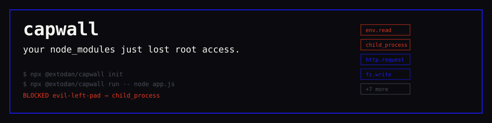

<p align="center">
  <picture>
    <source media="(prefers-color-scheme: dark)" srcset="docs/capwall-logo-dark.svg">
    
  </picture>
</p>
<h3 align="center">your node_modules just lost root access</h3>

# @extodan/capwall

**Per-package runtime permissions for `node_modules` — and for the AI coding agents and MCP servers that touch them.**

Every `npm install` pulls in packages you've never read. Any of them can read `process.env`, spawn shells, and open sockets — the exact powers behind every npm supply-chain attack. Capwall makes each one ask permission: **11 capabilities**, scanned statically, locked in a reviewed `capabilities.lock`, enforced fail-closed inside V8.

[](https://github.com/Extodan/Capwall-OSS/actions/workflows/ci.yml)
[](LICENSE)
[](https://www.npmjs.com/package/@extodan/capwall)

<p align="center"></p>

## Quickstart (60 seconds)

```bash
npx @extodan/capwall init     # AST-scan node_modules → capabilities.lock (review the diff!)
npx @extodan/capwall verify   # CI gate: exit 1 on drift between lock and tree
npx @extodan/capwall run -- node app.js   # enforce — unauthorized use throws, host code untouched
```

Or install it: `npm i -D @extodan/capwall` — then `capwall …` in your npm scripts.

Production enforcement (one line, no CLI): `node --import @extodan/capwall-runtime-node app.js`

## What a blocked attack looks like

From the air-gapped exploit lab (`pnpm sim:demo` in the repo) — three benign reproductions of 2026 supply-chain attack patterns:

```
│ vector                                     │ standard node.js    │ capwall-protected     │
│ legit stripe charge                        │ ALLOWED             │ ALLOWED (~µs)        │
│ axios→plain-crypto-js (.env theft + exfil) │ PWNED — keys out    │ BLOCKED              │
│ Shai-Hulud worm (SSH key read + raw TCP)   │ PWNED — key gone    │ BLOCKED              │
│ rogue MCP (path traversal + shell spawn)   │ PWNED — shelled     │ BLOCKED              │
└────────────────────────────────────────────┴─────────────────────┴──────────────────────┘
RESULT: ALL VECTORS BLOCKED — legit traffic unaffected · attacker-sink: 2 hits vs 0
```

## How it works

1. **Scan** (`init`) — acorn AST + capability dataflow (aliases, base64 de-obfuscation, cross-file taint) over your installed tree. Nothing executes.
2. **Lock** — grants land in `capabilities.lock`, plain JSON, reviewed in a PR like everything else.
3. **Enforce** (`run`) — a `--import` hook gates every builtin require/import per calling package, wraps `process.env` and `fetch` with stack attribution, sanitizes Node gadget options (null-prototype clones), and can freeze primordials at bootstrap. Fail-closed by design.
4. **Attest** (`attest`) — every pipeline step emits Ed25519-signed in-toto/DSSE envelopes; `attest verify` proves the enforced lock is bit-identical to the scanned one.
5. **Agents too** (`wrap`, `mcp`, `taint`) — a two-axis taint lattice for AI agents, MCP `tools/list` schema pinning against rug-pulls, and implicit-tool-poisoning detection.

## Command reference

```
scan [dir] [-v]                     AST + dataflow report
init [dir]                          write capabilities.lock (capabilities + import graph)
verify [dir]                        lock vs tree drift; exit 1 (CI-ready)
run [--mode=enforce|audit] -- <cmd> enforce; audit observes without blocking
allow|deny <pkg> <cap…>             edit grants (deny-to-zero keeps a blocking entry)
show · capabilities                 inspect the lock / list the 11 capabilities

wrap [--agent=claude|cursor|codex|mcp] -- <cmd>   DIFC shield around agents/MCP/lifecycle
mcp scan|lock <server> -- <cmd>      ITP audit + SHA-256 schema pinning
taint status|clear                   persisted cross-session taint ledger

keys generate · attest layout|emit-all|verify · sbom export --format=cyclonedx
```

Full details: [README on GitHub](https://github.com/Extodan/Capwall-OSS#readme) · every flag in [`packages/cli`](https://github.com/Extodan/Capwall-OSS/tree/main/packages/cli).

## Try it on a real repo

Point the free scanner at `github.com/Extodan/Capwall-OSS/tree/main/examples/risky-app` — eight hugely popular packages (ssh2, esbuild, cross-spawn…), every stat honestly non-zero. Or clone the repo and run `pnpm sim:demo` for the blocked-attack table above, live.

## Honest boundaries

A capability **gate**, not a cryptographic sandbox: it stops the standard attack paths at the module boundary, refuses to promise enforcement when it can't prove it loaded first, and says so loudly. Details in the repo README.

Apache-2.0 · Node ≥ 20.6 · [github.com/Extodan/Capwall-OSS](https://github.com/Extodan/Capwall-OSS)
